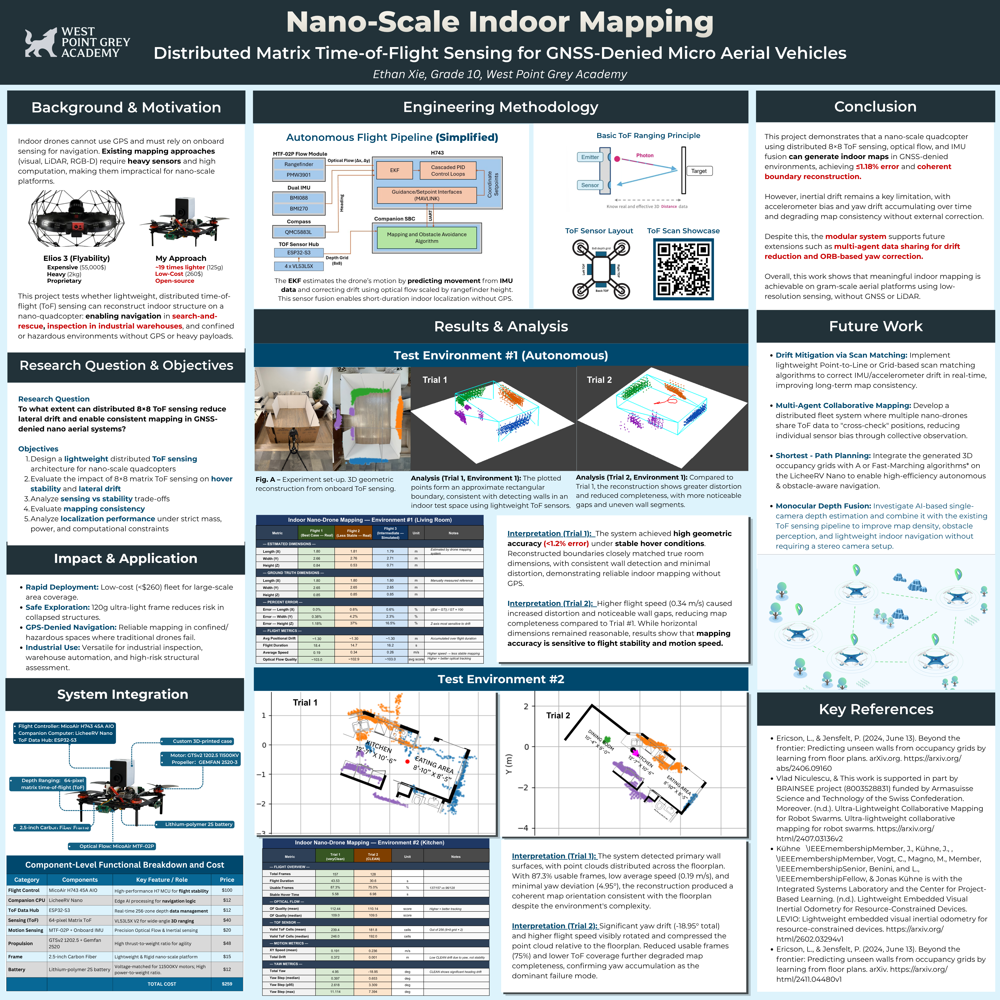
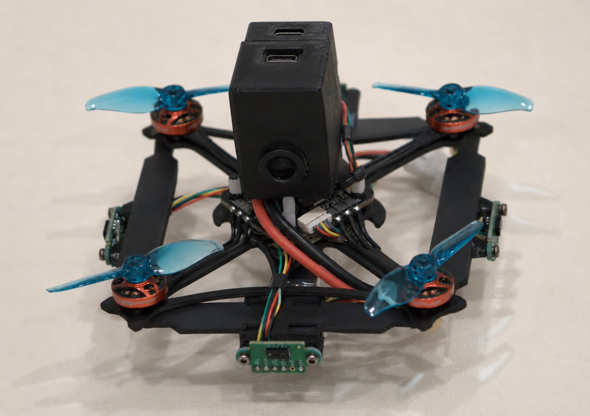
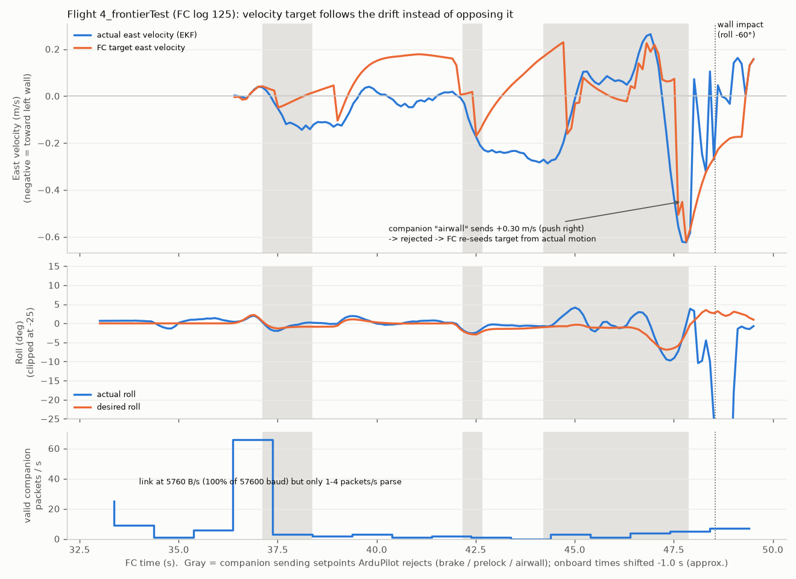
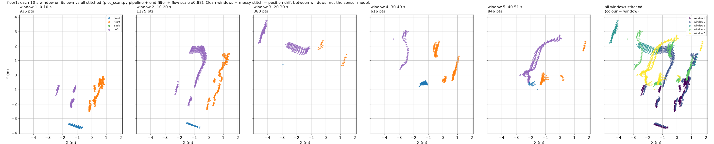
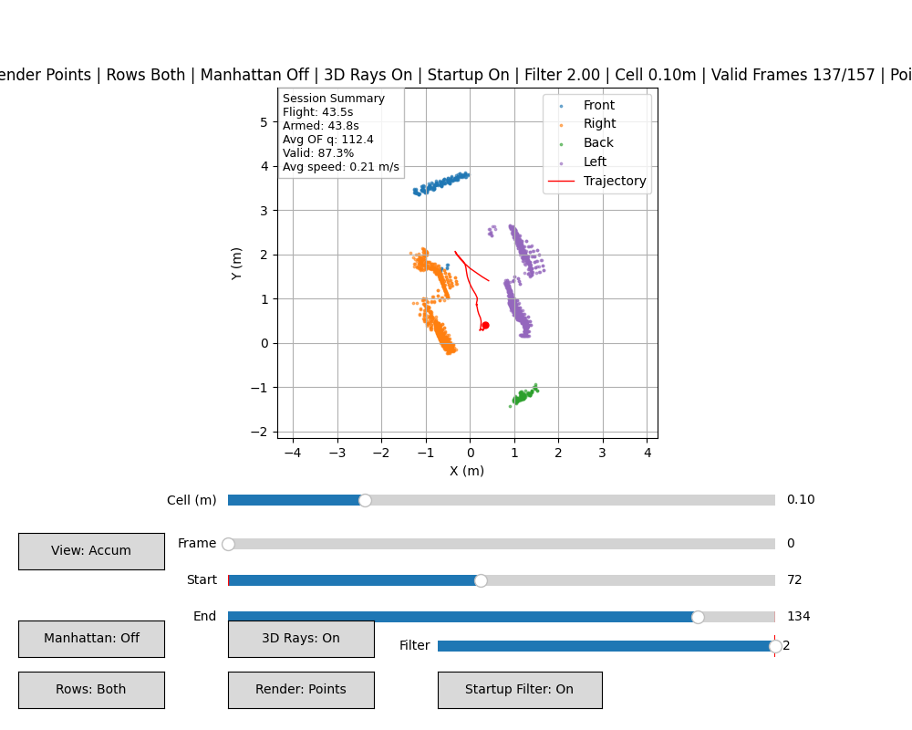

# Indoor GPS-Denied Nano-Quadcopter Mapping

## Overview

This project investigates whether a nano-scale quadcopter can perform autonomous indoor localization and mapping without GPS under strict size, power, and computational constraints.

The system combines optical flow velocity estimation, time-of-flight (ToF) depth sensing, and a lightweight companion-computer logging pipeline to reconstruct a 2D map of the environment from flight data.

The goal is to explore whether a highly constrained nano-quadcopter platform can support GPS-denied navigation and mapping for applications such as search-and-rescue, structural inspection, and confined-space exploration.

The full project — methodology, results, and analysis — is summarized in the science fair poster below:


*Figure: Science fair poster presenting the system design, methodology, and key findings.*


*Figure: Earlier prototype of the nano-quadcopter platform*

---


## Features

- GPS-denied indoor flight
- Optical flow-based velocity estimation
- ToF-based environment sensing
- Modular sensor and compute architecture
- Companion-computer logging pipeline
- Post-flight 2D map reconstruction

---

## System Architecture

The system consists of three main subsystems:

1. **Flight Controller** (ArduCopter 4.6.3)  
   Handles stabilization, the optical-flow EKF, and low-level position control

2. **Sensor Hub (ESP32-S3)**  
   Reads four VL53L5CX 8×8 ToF sensors (front/right/back/left) and forwards M5Stack arm/disarm commands

3. **Companion Computer (LicheeRV Nano / earlier Luckfox Pico Mini B)**  
   Runs the flight state machine and frontier exploration, streams GUIDED setpoints over MAVLink, and logs flight and sensor data for post-flight reconstruction

Data flow:

Sensors → ESP32-S3 → Companion Computer → Post-processing → 2D Map

---

## Hardware

### Version 1

| Component | Part |
|-----------|------|
| Sensor Hub | Waveshare ESP32-S3 Zero |
| Mapping / Vision SBC | Luckfox Pico Mini B |
| Flight Controller | MicoAir H743 45A V2 AIO |
| Motors | 1202.5 11500KV |
| Frame | 85mm Mobula8 Whoop Frame |

### Version 2

| Component | Part |
|-----------|------|
| Sensor Hub | Waveshare ESP32-S3 Zero |
| Mapping / Vision SBC | LicheeRV Nano |
| Flight Controller | MicoAir H743 45A V2 AIO |
| Motors | 1103 11000KV |
| Frame | 2" Carbon Fiber |

### Version 3 (Current)

| Component | Part |
|-----------|------|
| Sensor Hub | Waveshare ESP32-S3 Zero |
| Mapping / Vision SBC | LicheeRV Nano |
| Flight Controller | MicoAir H743 45A V2 AIO |
| Motors | 1202.5 11500KV |
| Frame | 2.5" Carbon Fiber |
| Propellers | 2.5" Bi-blade |
| ToF sensors | 4 × VL53L5CX (8×8 zones, 45° × 45° FOV) |

Approximate AUW: ~135g  
Battery: 2S LiHV

---

## Control & Tuning

### April 2026 (values in the flight logs)

### Roll & Pitch

| Parameter | Value |
|-----------|-------|
| ATC_RAT_RLL_P / ATC_RAT_PIT_P | 0.0242 |
| ATC_RAT_RLL_I / ATC_RAT_PIT_I | 0.012 |
| ATC_RAT_RLL_D / ATC_RAT_PIT_D | 0.0018 |

### Yaw

| Parameter | Value |
|-----------|-------|
| ATC_RAT_YAW_P | 0.18 |
| ATC_RAT_YAW_I | 0.018 |
| ATC_RAT_YAW_D | 0.0 |

### Position controller and motors

| Parameter | Value |
|-----------|-------|
| PSC_POSXY_P | 0.5 |
| PSC_VELXY_P / I / D | 0.6 / 0.2 / 0.1 |
| MOT_SPIN_MIN | 0.13 |
| MOT_THST_HOVER | 0.125 (pinned at the parameter's minimum; measured hover throttle ≈ 0.11) |

### January 30, 2026 (earlier tune, for reference)

| Parameter | Value |
|-----------|-------|
| ATC_RAT_RLL_P / PIT_P | 0.07 |
| ATC_RAT_RLL_I / PIT_I | 0.06 |
| ATC_RAT_RLL_D / PIT_D | 0.0045 |
| ATC_RAT_YAW_P / I / D | 0.05 / 0.015 / 0.0 |

Recommended changes from the post-season analysis (not yet flight-tested): rate I equal to rate P, `PSC_POSXY_P` back to the default 1.0, redo the accelerometer level calibration (hover pitch sat ~1.2° nose-up in every flight), calibrate `FLOW_FXSCALER`/`FLOW_FYSCALER`, fix or disable the compass (it was present but unhealthy and never fused), and re-enable `ARMING_CHECK`.

---

## Results

Test flights were conducted in small indoor rooms and hallways.

Key observations:

- The quadcopter hovered using ArduPilot's optical-flow position hold; flights lasted 12–50 s
- Short-duration mapping is feasible on a nano-scale platform: individual ~10 s stretches of flight produce coherent wall segments
- Drift accumulation is the dominant limitation: walls seen again later in a flight land tens of centimetres away from their first sighting
- The optical-flow odometry over-reported distance travelled by roughly 4–16% (measured from ToF range changes; ×0.875 on the longest flight)
- Autonomous (companion-computer) control was largely ineffective — see the post-season analysis below
- The project demonstrates the practicality of modular indoor mapping on a constrained quadcopter platform, and identifies concrete fixes for the control link

---

## Post-Season Analysis (November 2026)

A review of the ArduPilot dataflash logs, onboard logs and ToF scan logs found the main causes of the drift, the "tilting to one side" crashes, and the stalled frontier exploration. Full write-up with figures: [`analysis/REPORT.md`](analysis/REPORT.md); list of code changes: [`CHANGES.md`](CHANGES.md).

### Why the drone drifted and crashed

1. **The companion→FC link was saturated.** The control loop ran on every serial wake-up (hundreds of Hz) and wrote setpoints to a non-blocking UART at 57600 baud without checking `write()`. The FC received 5,760 B/s (100% of the link) but only **1–4 valid packets per second**; the rest arrived as fragments that failed CRC. Commands that did arrive (including LAND and DISARM) were delayed 0.7–0.9 s.
2. **Most hold setpoints were rejected by ArduPilot.** ArduCopter treats a `SET_POSITION_TARGET_LOCAL_NED` field group as ignored if *any* of its mask bits is set. The prelock hold, "Z-only" hold, takeoff brake, airwall push and locked ceiling hold all mixed bits (e.g. "ignore x,y but use z"), so ArduPilot reset its position controller to the drone's *current* position, velocity and lean on each one. Drift was accepted instead of corrected, and the takeoff altitude target was thrown away (0.75–0.81 m instead of 0.50 m).
3. **Both recorded crashes were the airwall pushing the wrong way.** Near the left wall (11–15 cm), the airwall's "push right" command was rejected, the FC re-seeded its target from the drone's leftward motion, and the drone accelerated into the wall.

### Why frontier exploration stalled

- With four 45° sensors and no yaw, the only "frontiers" in the small test room were the blind wedges between the sensors.
- 0.25 m steps were smaller than the position noise, and the progress check aborted moves on 2 cm of noise.
- A last-write-wins occupancy grid left single noisy cells that blocked paths to real frontiers.
- The onboard map used a 70° FOV (the VL53L5CX is 45°) and treated perpendicular depth as range along the ray, which bent walls.

### Mapping findings

- The VL53L5CX reports **perpendicular depth**; `plot_scan.py`'s depth model is correct (walls are 5× straighter under it on 1,284 flat-wall views).
- Ending the map at the last stable hover (removing landing/crash frames) and correcting the measured flow scale reduced double walls on the longest flight by ~31%.
- Offline scan matching did not reliably improve the maps: scans are too sparse (~23 points) to anchor the optical-flow drift.

### Fixes in `frontier.c` and `tof_esp32.ino` (implemented, not yet flight-tested)

- Fixed-rate 25 Hz control loop, one whole setpoint per tick, never fragmented; `--fc-baud` option (use 921600 with `SERIAL5_BAUD = 921`)
- Only mask shapes ArduCopter accepts; airwall moves the hold point away from the wall
- ToF: middle rows only, invalid zones dropped (firmware filters by `target_status`), depth-to-range correction, ARM requires two frames
- Frontier: log-odds occupancy, 45° yaw sweep to fill sensor gaps, ≥0.6 m targets, noise-tolerant progress check

The as-flown `frontier.c` is preserved in git history (commit "Add frontier.c as flown (April 2026)"), so the fixes can be reviewed as a diff. A test harness, `analysis/tests/test_frontier.c`, compiles the real `frontier.c` and checks the setpoint masks, the serial writer and the frontier code on recorded scans.


*Figure: FC log of a crash flight. Gray = companion setpoints that ArduPilot rejected; the FC's target velocity (orange) follows the drone's own drift (blue) into the left wall.*


*Figure: Each 10 s window of the floor1 flight is locally coherent; stitching the windows exposes optical-flow drift.*

---

## Mapped Environment


.png)

---

## Repository Structure

- `README.md` — project overview, hardware versions, tuning notes, results, and post-season analysis
- `frontier.c` — current autonomous flight + frontier exploration code (post-season fixes applied)
- `CHANGES.md` — list of post-season code fixes and how they were verified
- `analysis/` — post-season report (`REPORT.md`), log-analysis and map clean-up scripts, test harness, figures
- `clean_uav_fc_tof_nav.c` — earlier autonomous flight code (predates the fixes)
- `manual_uav_fc_tof_nav.c` — manual flight controller version with logging
- `uav_local_nav.c` — local navigation logic (earlier version)
- `plot_scan.py` — mapping / scan visualization script
- `plot_scan_3d.py` — variant combining ToF points and rangefinder data into a 3D approximation
- `flight_session_viewer.py` — GUI for browsing arm sessions in onboard log files
- `tof_esp32.ino` — ESP32 sensor hub firmware (filters invalid zones by `target_status`)
- `m5stack_armDisarm.ino` — M5Stack arm/disarm helper
- `Figure_1.png`, `image (9).png`, `mapped_environment_2.png` — example mapped environment outputs

---

## Build

### SCP Command: log.txt
```
scp root@10.98.143.1:/mnt/sdcard/log.txt "$env:USERPROFILE\Downloads\log.txt"
```
### SCP Command: scanlog.bin
```
scp root@10.98.143.1:/mnt/data/scanlog.bin "$env:USERPROFILE\Downloads\scanlog.bin"
```
Note: the onboard logger appends to `scanlog.bin`, so one file can hold several flights, each starting at position (0, 0). Plot sessions separately.

### Compile Command

```bash
riscv64-linux-gnu-gcc -Os -std=gnu11 -Wall -Wextra -static \
  -ffunction-sections -fdata-sections -Wl,--gc-sections \
  -I"$HOME/c_library_v2" \
  frontier.c -o uav_fc_tof_nav_riscv_static -lm
```
Build with warnings on (the earlier command used `-w`, which hides every warning).

Run with the FC link speed matching `SERIAL5_BAUD` on the flight controller (921600 recommended):
```bash
./uav_fc_tof_nav_riscv_static --fc-baud 921600            # frontier exploration
./uav_fc_tof_nav_riscv_static --fc-baud 921600 --hover-only
```

### Map clean-up and log analysis (Python)
```bash
pip install pymavlink numpy scipy matplotlib
export FLIGHT_DATA=/path/to/flight-data     # contains fc_blackbox/ and onboard/
python analysis/scripts/cleanup_scanlog.py $FLIGHT_DATA/onboard/scanlogs/floor1_scanlog.bin
python analysis/scripts/windowed_maps.py   $FLIGHT_DATA/onboard/scanlogs/floor1_scanlog.bin
```
