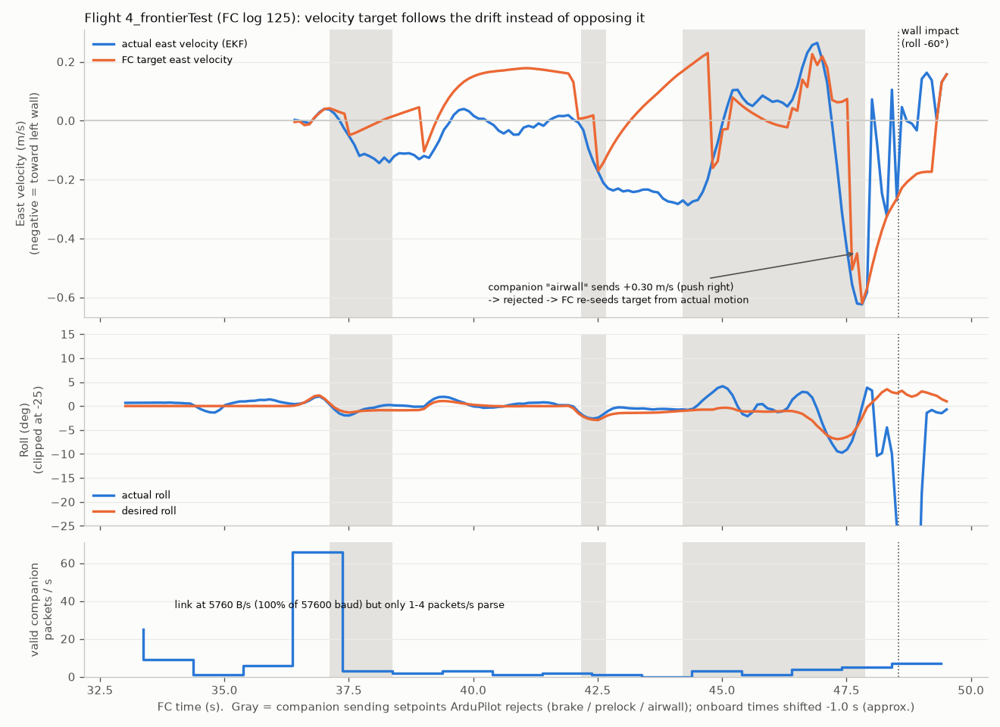
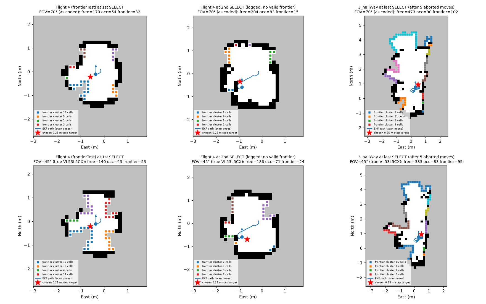

# Year 1 post-mortem: why the micro-quad tilted, drifted, crashed, and why frontier exploration stalled

Data analysed: 6 ArduPilot dataflash logs (`fc_blackbox/QUADROTOR/1/*.bin`, ArduCopter 4.6.3, MicoAir H743v2),
20 onboard text logs, 10 ToF scan logs, `frontier.c` (5,543 lines) and the full git history of
`exie1122/micro-quad-SLAM`. Every claim below cites the log or source line that supports it. Things I checked
that turned out *not* to be problems are listed in §6 so you know they were ruled out.

Scripts that reproduce every number are in `analysis/scripts/` (pymavlink + numpy + matplotlib).

---

## TL;DR — the three root causes

1. **The companion→FC link was saturated and ~97% of packets never parsed.** SERIAL5 received 5,760 B/s
   (exactly 100% of 57,600 baud), but `MAV chan 3 rxp` advanced by only **1–4 valid packets per second** in all six
   flights. The cause: the main loop runs every time `poll()` sees a byte (≥88 Hz, unbounded). Each tick it writes a
   65-byte setpoint to an `O_NONBLOCK` fd and ignores `write()`'s return value. Once the kernel TX buffer fills, every
   write is a *fragment*, so the FC receives chopped frames that fail CRC. Commands that did get through were
   **0.7–0.9 s late** (LAND and DISARM included).

2. **Most of the "hold" setpoints you wrote are rejected by ArduPilot, and the rejection *resets* the controller.**
   ArduCopter 4.6.3 treats a field group (position / velocity / accel) as ignored if **any** of its bits is set. Any
   message that mixes, say, "ignore x,y" with "use z" fails every branch and calls `mode_guided.init(true)`, which runs
   `init_xy_controller()` / `init_z_controller()`. Those set **target position = current position, target velocity =
   current velocity, and the I-term from the current lean**. Prelock hold, "Z-only" hold, takeoff brake, airwall
   repulsion and the locked ceiling hold are all invalid in this way. They were active for **29–100% (median ≈60%) of
   companion-controlled flight time**.

3. **Together they produce the crash signature.** Near a wall, the airwall code says "push away" with an invalid
   message. ArduPilot replaces that with "keep doing what you're doing", so the drone **accelerates toward the wall
   it is trying to avoid.** Both recorded crashes (FC logs 125 and 132) happened exactly this way, into the left wall
   at 0.11–0.15 m.

The frontier explorer failed for separate reasons (§5). The main ones:
- The drone never yaws, so its only "frontiers" in the small test room were **the blind wedges between its own four
  sensors**.
- Steps were 0.25 m, which is inside the localisation noise.
- Single noisy cells in a last-write-wins occupancy grid blocked line-of-sight to the real frontiers down the hallway.

---

## 1. The link: 100% busy, ~3% useful

| FC log | SERIAL5 Rx B/s (median, airborne) | capacity | valid companion packets/s |
|---|---|---|---|
| 117 | 5,754 | 5,760 | 2.0 |
| 119 | 5,760 | 5,760 | 4.0 |
| 121 | 5,760 | 5,760 | 3.0 |
| 125 | 5,760 | 5,760 | 2.5 |
| 132 | 5,757 | 5,760 | 4.0 |
| 124 (3_frontierTest) | 5,760 | 5,760 | 4.0 |

Sanity check: after disarm the setpoint stream stops. `rxp` then jumps to ~20/s while the backlog drains and settles
at 1/s at 21 B/s, which is exactly one MAVLink2 heartbeat. So the counter means what I'm using it for.

How the code produces this (`frontier.c`):
- `main()` calls `control_tick()` after **every** `poll()` wakeup (`frontier.c:5520-5532`). Nothing limits it to the
  "50 Hz" the comments assume, and every tick sends at least one `SET_POSITION_TARGET_LOCAL_NED`. Some ticks send two:
  takeoff brake plus ceiling hold, or hover plus ceiling hold.
- `open_uart()` opens with `O_NONBLOCK` and never clears it. `mav_send()` does `int ret = write(...); (void)ret;`
  (`frontier.c:1006-1013`). A partial write throws away the rest of the frame.
- Uplink budget at 57,600 baud ≈ 88 setpoints/s. Downlink is also heavy: you request OPTICAL_FLOW **and**
  OPTICAL_FLOW_RAD, DISTANCE_SENSOR **and** RANGEFINDER, SERVO_OUTPUT_RAW at 20 Hz, and so on (FC Tx ≈ 4,400 B/s).
- `EKF_STATUS_REPORT` never arrived (`ekf_ph=nan` in every log). So every EKF-variance gate in the code
  (`EKF_POS_VAR_LOCK_MAX`, `EKF_POS_VAR_BREAK`) was silently disabled.
- Side effect: the apparent onboard→FC clock offset varies from 1.83 s (takeoff command, queue empty) to 0.97 s
  (DISARM, queue full). That difference is the TX queue delay.

## 2. Which setpoints ArduPilot actually accepts

From `ArduCopter/GCS_Mavlink.cpp` @ Copter-4.6.3 (lines 1301–1385):
`pos_ignore = type_mask & (X|Y|Z_IGNORE)`, so it is true if **any** of those bits is set. The same rule applies to
velocity and accel.

| `frontier.c` function | mask bits | ArduPilot result |
|---|---|---|
| `send_pos_yaw_ned` (locked hold, frontier move) | 3–8, 11 | `set_destination` ✅ (GUIP type 2) |
| `send_vel_frame`, unlocked `send_ceiling_hold` | 0–2, 6–8 | `set_velaccel` ✅ (GUIP type 4) |
| `send_prelock_hold` (**also used by the airwall**) | 0,1,5,6–8,11 | **`init(true)` → controller reset** ❌ |
| `send_z_yaw_ned` ("Z-only" hold) | 0,1,3–8,11 | **reset** ❌ |
| takeoff brake (inline, `frontier.c:5282`) | 0,1,5,6–8,11 | **reset** ❌ |
| `send_ceiling_hold` while XY-locked | 2,3,4,6–8,11 | **reset** ❌ |

The FC logs agree: `GUIP` only ever records types 2 and 4, never 3 (pos+vel).

What a reset does (`AC_PosControl.cpp` `init_xy_controller()` / `init_z_controller()`):
`_pos_target = current position`, `_vel_target = current velocity`, roll/pitch targets from the current attitude,
and the velocity I-term initialised from the current lean. In plain terms: **"forget the error and keep doing what
you're doing."** This explains three things:

- **Takeoff overshoot to 0.74–0.81 m** (target 0.50; see the `TAKEOFF_BRAKE: settled alt=…` lines). The brake's
  z = 0.50 target is thrown away, and the reset keeps the current climb rate. Only the (valid) ceiling velocity
  commands ever pulled it back down.
- **XY lock breaking on 0.30 m drift within 0.6–2.5 s.** Every lock break, post-move settle and airwall event resets
  the target to wherever the drone has drifted to, so drift is *accepted* instead of corrected. You can see `TPN/TPE`
  jump onto `PN/PE` in the FC log (e.g. log 125 at 44.7→45.0 s).
- **Consistent leaning in one direction.** Whatever lean and velocity the drone has at a reset become the new trim.

History: January's `uav_local_nav.c` used only the two valid mask shapes. The rejected shapes arrived with the
"Z-only" hold (commit `3c878c6`, Feb 19) and the prelock/ceiling holds (`1813fec`, Mar 25). Each later "stability
fix" added a hold mode that never reached the controller.

## 3. Crash forensics

**FC log 125 = `4_frontierTest_log.txt`.** In onboard time:
- At 47.2–48.6 s the left ToF reads **0.15 m**. The airwall computes `vy=+0.30` (push right) and sends it through
  `send_prelock_hold` → rejected → reset.
- The FC's target east velocity follows the actual motion to **−0.45 m/s**, and the drone accelerates to −0.62 m/s
  toward the left wall with a commanded 6–10° left roll.
- LAND begins at FC 47.82 s (the command arrived ~1 s late). At FC 48.7 s, roll is **−60°** with desired +2.4° at
  0.2 m altitude, which is a wall strike. The motors were saturated (M3 at the 1130 floor, M1/M4 ≈ 1700+).

**FC log 132 = `changedEnvironment_log.txt` session 4.** The takeoff brake never settled ("Brake Timeout"), so the
**whole flight** was rejected masks. The airwall was active from 28.6 s on, with L = 0.32 → 0.23 → **0.11 m**. The
drone drifted left at 0.61 m/s and hit at 0.34 m altitude: roll −131°, then a tumble. The "359° yaw span" in this log
is the tumble, not a yaw spin.

## 4. Contributing FC configuration / hardware issues

These don't explain the crashes alone, but each makes them more likely:

- **Compass unhealthy, and pre-arm checks disabled.** `SYS_STATUS` shows the 3D-mag bit as present and enabled but
  **unhealthy**. `XKF4.SM = 0` throughout, so no mag data was fused, yet `EK3_SRC1_YAW = 1` (compass) and
  `ARMING_CHECK = 0`. Yaw was gyro-only. The code's "magnetometer interference near walls" yaw guardian was guarding
  against a sensor that wasn't being used. Either fix the compass or configure EKF3 for no-compass operation per the
  ArduPilot docs, and turn `ARMING_CHECK` back on ("Arm: Need Position Estimate" appears in log 119 and was ignored).
- **Hover throttle pinned at the parameter floor.** `MOT_THST_HOVER = 0.125` is the minimum ArduPilot allows; the
  measured hover throttle is **0.106–0.110**. The Z controller's feed-forward is therefore biased upward (more takeoff
  overshoot). Downward motor authority is small (motors hit the 1130 µs floor in the crash). The quad has a very high
  thrust-to-weight ratio for indoor hover (11,500 KV on 2S with 2.5" props), which is also why the rate gains had to
  be cut so far.
- **Weak rate integrator.** `ATC_RAT_RLL/PIT_I = 0.012` is half of P (0.024); ArduPilot's usual guidance is I = P.
  Every flight shows a **steady 1.0–1.8° gap between desired and actual roll/pitch**, with the rate I-terms near zero.
- **Consistent ~1.2° nose-up hover trim** (+2.3, +0.9, +1.3, +1.3, +1.1° across five flights). The accelerometer
  level calibration or the frame/motor mounts are off. After any reset the drone leans ~1.2° "forward" and drifts
  forward (`vN > 0` at takeoff in 5 of 6 flights).
- **Optical flow never scale-calibrated** (`FLOW_FXSCALER/FYSCALER = 0`). Orientation is correct (see §6), but scale
  errors turn directly into map scale errors.
- **Low position gains** (`PSC_POSXY_P = 0.5`, half the default). After a disturbance the FC takes 1–1.5 s to reverse
  a 0.3 m/s drift (log 132, 28.0–29.9 s).
- **The "thrust ramp" isn't a thrust ramp.** With `GUID_OPTIONS = 0`, `SET_ATTITUDE_TARGET.thrust` is read as a
  **climb-rate request** (0.5 = hold, 1.0 = max climb; `mode_guided.cpp:619-665`), so the "thrust ramp" and liftoff
  assist were really climb-rate ramps.

## 5. Why frontier exploration didn't work

These maps come from a Python port of `frontier.c`'s mapping and selection code (`scripts/frontier_replay.py`)
replayed on the logged ToF frames. It reproduces the onboard choice: flight 4's first SELECT picks a 15-cell cluster
at (−0.70, −0.94) in the replay vs (−0.68, −0.95) onboard.

1. **The drone chases its own blind spots.** Four 45° sensors cover 180° of the circle, and the drone never yaws. In
   the frontierTest room (~2.3 × 2.6 m, walls about 1 m away in every direction) the whole room is visible from
   takeoff. The **only** frontiers are the four diagonal wedges between sensors (bottom-left panel), and the chosen
   target is in the SW wedge. A 0.25 m translation doesn't close a wedge that moves with the drone. "No valid
   frontier" in that room is mostly the correct answer reached the hard way.
2. **Wrong FOV.** `FRONTIER_SENSOR_FOV_DEG = 70`, but the VL53L5CX's field of view is 45° × 45°. Rays are fanned 55%
   too wide, so walls bend outward. That is the README's "curvature artifacts".
3. **Steps are smaller than the noise.** `FRONTIER_STEP_MAX_M = 0.25` with `FRONTIER_ARRIVAL_TOL_M = 0.20`, while the
   XY lock itself breaks at 0.30 m drift. The progress gate aborts if error grows by more than 2 cm in 2 s. On top of
   that, setpoints arrive 0.7–1.4 s late over a lossy link. In 3_hallWay, 5 of 6 moves were aborted for "no progress"
   with errors of 0.21–0.48 m.
4. **Speckle obstacles block real frontiers.** The grid is last-write-wins: one ray marks a cell OCCUPIED, the next
   marks it FREE. Isolated noisy returns leave single black cells in open corridor, and `frontier_line_clear` rejects
   any path through them. In 3_hallWay's last SELECT, **54 candidate paths** toward the real frontiers 3–4.5 m up the
   hallway were rejected as `path_occ`.
5. **Nearest-first scoring.** The score is dominated by distance, so the drone keeps picking 0.25 m hops toward
   nearby noise clusters instead of the corridor end.
6. **Floor in the field of view (possible, weakly supported).** In one flight (7_frontierTest) an edge row tracked
   altitude (front row 7 = 1.55 m at 0.45 m altitude, correlation +0.87). Pooled over all flights, though, no edge row
   reliably tracks altitude (see the addendum), so most "floor-like" outer-row readings were probably walls ~1.5 m
   away. Using only the middle rows avoids the issue either way.
7. **The ESP32 ignores `target_status`** and sends `distance_mm` for zones the sensor marked invalid. The companion
   only filters out 0 / 0xFFFF / <20 mm. Effective scan rate was **5 Hz** (196 ms spacing), not 10 Hz.
8. **"No frontier" lands the aircraft** even when frontiers exist but every one was rejected by the filters above
   (hallWay_log: 136 frontier cells, 8 clusters, still "no valid frontier").
9. Minor: each SELECT scans the whole 1024×1024 grid and runs a 21×21 clearance search per path sample. That froze
   the control loop for ~100 ms (3_hallWay 132.597→132.705). Not fatal, but it is also when the link briefly clears,
   which is part of why only a random handful of packets get through.

## 6. Checked and ruled out

- **Optical flow orientation:** `flowX`/`bodyX` and `flowY`/`bodyY` correlate positively in all logs (+0.41…+0.88).
  No axis flip.
- **Stale ToF frames:** 0 identical consecutive frames in the scan logs. The ESP32 loop is slow enough that data is
  always new.
- **ToF left/right mapping:** in log 125 the drone moving toward its left coincides with L shrinking, so the mapping
  is consistent.
- **Compiler hygiene:** compiled with `-Wall -Wextra -Wformat` and a `format(printf)` attribute added to `log_msg`.
  No real warnings. The bugs are semantic, not syntactic. (The build uses `-w`, so you'd never have seen warnings
  anyway; drop it.)

## 7. Fix list, in priority order

1. **Rate-limit the loop.** Send setpoints at a fixed 20–30 Hz (`timerfd` or a `next_send_ms` check), check
   `write()`'s return value (or use a blocking fd for TX), and raise SERIAL5 to 921,600 (`SERIAL5_BAUD = 921`, plus
   the UART on the LicheeRV). Stop requesting the duplicate streams.
2. **Only send mask shapes ArduPilot accepts:** pure position (bits 3–8 + 11 set), pure velocity (bits 0–2 + 6–8 + 10
   or 11), or **full** position + velocity (bits 6–8 + 11 only, with x, y, z all filled in). For "hold XY, push away
   from the wall", move the *position target* away from the wall instead of sending a velocity with ignored XY.
   Add a startup self-test that sends each shape and checks `GUIP` / `POSITION_TARGET_LOCAL_NED` echoes.
3. **FC configuration:** fix or disable the compass and set the EKF yaw source to match; re-enable `ARMING_CHECK`;
   redo the accelerometer level calibration; set rate I ≈ P; calibrate the flow scalers; consider lower-KV motors or
   smaller props so hover sits well above the throttle floor.
4. **Frontier:** set FOV = 45°; add a 45° yaw scan in `HOVER_SCAN` (or exclude cells inside the sensor gaps from
   frontier detection); use a log-odds occupancy grid with a minimum hit count; pick targets ≥0.6–1.0 m away and
   score on information gain, not just distance; make the progress check tolerant (e.g. 10 cm per 3 s); filter by
   VL53L5CX `target_status` (keep 5 and 9) and use only the middle rows, tilt-compensated.
5. Restore the data you lost: request `EKF_STATUS_REPORT` once the link has room, and raise `LOG_BITMASK` so ATT/RATE
   are logged fast enough to debug attitude (they're ~18 Hz now).

## Addendum (later findings)

- **Flow scale.** In every flight with enough data, ToF range changes show the optical-flow odometry over-reports
  distance travelled by ~4–16% (×0.875 [95% CI 0.84–0.92] on floor1). Correcting it reduced double walls on floor1
  by ~31% (`scripts/cleanup_scanlog.py`).
- **Range model.** The VL53L5CX reports *perpendicular depth*: walls are ~5× straighter under that model on 1,284
  flat-wall views, and head-on edge/centre readings match (ratio 0.996). `plot_scan.py` already handles this; the
  onboard frontier map did not and has been fixed (`scripts/verify_range_model.py`).
- **Sensor mounting (hypothesis rejected).** A map metric suggested the right sensor's columns were mirrored, but a
  direct test (how a sensor's measured wall angle changes as the drone yaws) shows its column order is correct
  (slope −0.69, 95% CI −0.82 to −0.54; front control −0.53; mirrored would be +1). No firmware change was made
  (`scripts/verify_sensor_mounting_v2.py`).
- **Drift, not sensing, limits the maps.** Plotted in 10 s windows, floor1 shows coherent wall segments. Only
  stitching the windows together produces double walls (`figures/floor1_windows.png`). Offline scan matching
  (1 s chunks or whole windows) did not reliably improve the stitched map with these sparse scans.
- **Appended sessions.** The onboard logger appends to `scanlog.bin`; e.g. `4_hallWay_scanlog.bin` contains the
  3_hallWay flight followed by the 4_hallWay flight. Sessions must be plotted separately.

Running the scripts: they read flight data from `../../flight-data/` relative to `scripts/`, or from the directory
in the `FLIGHT_DATA` environment variable (containing `fc_blackbox/` and `onboard/`).

*Caveat:* several onboard logs come from slightly older builds than the local `frontier.c` (e.g. the "prev=" vs
"best=" progress messages). The mask/link findings are confirmed directly in the FC logs for every flight, so they
don't depend on which build flew.
